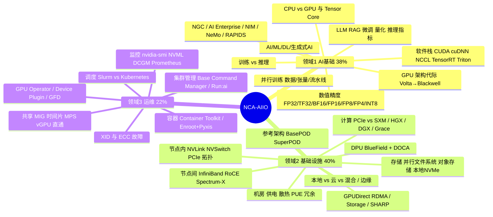

# NCA-AIIO 自学备考：知识体系 + 模拟考

目标认证：**NVIDIA-Certified Associate: AI Infrastructure and Operations（NCA-AIIO）**。
本目录把考试大纲拆成一张可以逐项打勾的知识树，每个考点都尽量挂到本仓库里**已经亲手做过的实验**上，
最后用两套 50 题模拟卷 + 随机组卷检验掌握程度。

> **信息来源说明（按本仓库"不写未验证内容"的规矩）**
> - 考试格式（50 题、60 分钟、US$125、在线监考、英文）和 "Essential AI Knowledge 38%" 来自 NVIDIA 官方认证页的搜索摘要；
>   "AI Infrastructure 40% / AI Operations 22%" 来自多个第三方备考指南，**本环境访问不到 nvidia.com，未能逐字核对**。
>   报名前请到官方页面确认：<https://www.nvidia.com/en-us/learn/certification/ai-infrastructure-operations-associate/>
> - 官方不公布及格线（scaled pass/fail）。本仓库模拟考把 **70% 作为自定及格线、80% 作为"可以去考"的线**。
> - 模拟题全部为自编练习题，按大纲方向出题，**不是真题、不是"题库泄露"**。考试时以英文出题，所以题干用英文，解析用中文。
> - 硬件参数（带宽、功耗、MIG 规格等）按 2026 年已发布产品整理，NVIDIA 产品更新很快，以官方数据手册为准。

## 目录

| 文件 | 内容 |
| --- | --- |
| [01-essential-ai-knowledge.md](01-essential-ai-knowledge.md) | 领域 1：AI 基础概念、GPU 架构代际、NVIDIA 软件栈、训练与推理（约 38%） |
| [02-ai-infrastructure.md](02-ai-infrastructure.md) | 领域 2：计算节点、NVLink/NVSwitch、InfiniBand/以太网、DPU、存储、机房供电散热、本地 vs 云（约 40%） |
| [03-ai-operations.md](03-ai-operations.md) | 领域 3：监控与 DCGM、Slurm/Kubernetes、GPU 共享与虚拟化、容器、故障排查（约 22%） |
| [04-cheatsheet.md](04-cheatsheet.md) | 考前一页速记：数字、命令、易混淆概念对照 |
| [flashcards/](flashcards/) | 736 张速记卡（27 个牌组）：翻卡页面（熟练度记录、反向模式、搜索）、[Markdown 全表](flashcards/flashcards.md)、Anki 导入文件 |
| [mock-exam/](mock-exam/) | 交互式模拟考场（计时、按领域出分、错题本）+ 100 题题库 + 答案解析 |

## 知识体系总图

## 考点 ↔ 本仓库实战对照

考 Associate 级别主要考"概念 + 选型 + 识别"，但你已经动手做过的部分会是最稳的得分点。

| 考点 | 你已经做过的证据 | 考试会怎么问 |
| --- | --- | --- |
| 容器访问 GPU（Container Toolkit、`--gpus`） | [故障记录 01](../runbooks/incident-01-docker-gpu-passthrough.md) | 容器里 `nvidia-smi` 找不到 / 看不到 GPU 的原因 |
| 驱动 vs CUDA Toolkit 版本关系 | [environment-baseline.md](../environment-baseline.md)（WSL 内 12.0 与 13.3 共存） | 宿主机只需要驱动；容器 CUDA 版本不能高于驱动支持的版本 |
| GPU 显存带宽、计算密集 vs 访存密集 | [local-gpu/benchmark.md](../local-gpu/benchmark.md)（vector_add 达到理论带宽 ~90%） | 为什么 GPU 适合 DL、HBM 带宽的意义 |
| DCGM / DCGM Exporter / 指标 | [metrics-support-matrix.md](../local-gpu/metrics-support-matrix.md)（DCGM 在消费卡+WSL2 不可用） | DCGM 用途、诊断级别、Exporter→Prometheus→Grafana 链路 |
| GPU 利用率的局限、监控盲区 | [local-gpu/analysis.md](../local-gpu/analysis.md) | "GPU util 100% 不等于算力吃满"，SM activity 等 profiling 指标 |
| 云上实例选择、成本 | [aws/instance-selection.md](../aws/instance-selection.md)、[aws/cost-safety.md](../aws/cost-safety.md) | 本地 vs 云的取舍（CapEx/OpEx、弹性、数据主权） |
| Kubernetes GPU（W3-4 计划） | `eks/`（待做） | GPU Operator 组件、`nvidia.com/gpu` 资源、MIG/时间片 |
| Slurm/NCCL（W6 计划） | `slurm/`（待做） | `sbatch/srun/squeue/sinfo`、`--gres=gpu:N`、NCCL all-reduce |
| LLM 推理（W7 计划） | `llm/`（待做） | TTFT/吞吐/批处理、TensorRT-LLM、Triton、NIM |

## 学习路线（4 周，可与 8 周实战计划并行）

每天 1–1.5 小时理论 + 已有的实战计划照常推进。每周末做一次测验，记录到下面的成绩表。

| 周 | 学习内容 | 当周测验 | 退出标准 |
| --- | --- | --- | --- |
| 第 1 周 | 领域 1 全部（01 文件）；把 GPU 代际表、精度表默写一遍 | 模拟考场「按领域练习 → 领域 1」 | 领域 1 练习 ≥ 75% |
| 第 2 周 | 领域 2 的 2.1–2.5（计算、互联、网络、DPU、存储） | 「按领域练习 → 领域 2」 | 能画出 SuperPOD 四张网络、说清 GPUDirect RDMA 路径 |
| 第 3 周 | 领域 2 的 2.6–2.8（机房、参考架构、本地/云）+ 领域 3 全部 | 「按领域练习 → 领域 3」 | 能对比 MIG / 时间片 / MPS / vGPU / 直通 五种方式 |
| 第 4 周 | 速记表 + 错题本 | 模拟考 A（计时）→ 复盘 → 模拟考 B（计时）→ 随机组卷 | 两套整卷都 ≥ 80%，且没有任何领域 < 70% |

**备考方法**：
1. 先读笔记里的"必会"小节，再刷对应领域的速记卡，然后做领域练习，错题进错题本（模拟考场自动记录在浏览器里）。
   速记卡每天 15–20 分钟，用"不会的优先"顺序；考前目标是 736 张里 ≥ 90% 进入"已掌握"。
2. 每道错题回到笔记对应小节（解析里标了 `§x.y`），用自己的话补一句到笔记的"我的补充"里。
3. 整卷模拟严格计时 60 分钟、一次做完，模拟真实考试节奏（平均 72 秒/题）。
4. 官方推荐课程（以官方页面为准）：NVIDIA DLI / Coursera 上的 *AI Infrastructure and Operations Fundamentals*；
   配合阅读 DGX SuperPOD 参考架构、DCGM 用户指南、GPU Operator 文档、MIG 用户指南。

## 成绩记录

| 日期 | 测验 | 总分 | 领域 1 | 领域 2 | 领域 3 | 备注 |
| --- | --- | --- | --- | --- | --- | --- |
| | | | | | | |
