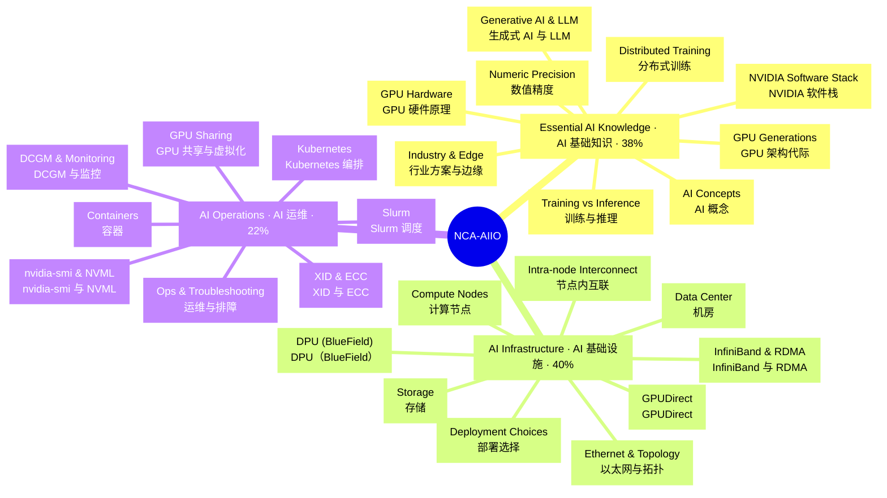

# NCA-AIIO 知识思维导图 · Knowledge Mind Map

> 由 `build.js` 从 `map-source.js` 生成，请勿手改。交互版（可折叠、搜索、双语/中文/EN 切换、点开看速记卡解释）见同目录 [index.html](index.html)。

## 总览 Overview

## 完整大纲 Full outline

### Essential AI Knowledge · AI 基础知识（38%）

- **AI Concepts · AI 概念**
    - AI ⊃ ML ⊃ DL · AI、ML、DL 的包含关系
    - Supervised learning · 监督学习
    - Unsupervised learning · 无监督学习
    - Reinforcement learning · 强化学习
    - Neural network · 神经网络
    - Backpropagation · 反向传播
    - Transformer · Transformer
    - Self-attention · 自注意力
    - Generative AI · 生成式 AI
    - Agentic AI · 智能体 AI
- **Training vs Inference · 训练与推理**
    - Workflow order · AI 工作流顺序
    - Training · 训练
    - Inference · 推理
    - Hardware priorities · 硬件侧重点
    - Pretraining · 预训练
    - Fine-tuning · 微调
    - Model optimization · 模型优化
    - Latency vs throughput · 延迟与吞吐的权衡
    - Checkpoint · 检查点
    - MLOps · MLOps
- **GPU Hardware · GPU 硬件原理**
    - CPU vs GPU · CPU 与 GPU
    - Why GPUs for DL · 为什么用 GPU 做深度学习
    - Streaming Multiprocessor (SM) · 流式多处理器
    - Tensor Core · 张量核心
    - RT Core (distractor) · RT Core（干扰项）
    - HBM · 高带宽显存
    - Memory bandwidth · 显存带宽
    - Compute- vs memory-bound · 计算密集 vs 访存密集
    - Warp (32 threads) · 线程束（32 线程）
    - Compute capability · 计算能力版本
- **GPU Generations · GPU 架构代际**
    - Volta · V100 · Volta · 首个 Tensor Core
    - Turing · T4 · Turing · 推理卡 T4
    - Ampere · A100 · Ampere · MIG / TF32
    - Ada · L4 / L40S · Ada · 推理与图形
    - Hopper · H100 · Hopper · FP8 Transformer Engine
    - H200 · H200 · 141 GB HBM3e
    - GH200 Grace Hopper · GH200 · NVLink-C2C
    - Blackwell · B200 · Blackwell · FP4 / NVLink 5
    - GB200 NVL72 · GB200 NVL72 机柜
    - "First introduced in" · “首次引入”速记
- **Numeric Precision · 数值精度**
    - FP32 · 单精度
    - TF32 · TF32（Ampere）
    - BF16 · BF16（同 FP32 范围）
    - FP16 · 半精度
    - FP8 (E4M3 / E5M2) · FP8（Hopper）
    - FP4 / NVFP4 · FP4（Blackwell）
    - INT8 / INT4 · 整数量化
    - Mixed precision · 混合精度训练
    - Quantization · 量化
    - Bytes per parameter · 每参数字节数
- **NVIDIA Software Stack · NVIDIA 软件栈**
    - Stack layers · 软件栈分层
  - **Libraries · 加速库**
      - CUDA · 并行计算平台
      - CUDA Toolkit · CUDA 工具包
      - cuDNN · 深度网络原语库
      - cuBLAS · 线性代数库
      - NCCL · 集合通信库
      - Magnum IO · 数据中心 IO 加速
  - **Inference · 推理**
      - TensorRT · 推理优化器
      - TensorRT-LLM · LLM 推理优化
      - Triton Inference Server · Triton 推理服务器
      - Triton dynamic batching · Triton 动态批处理
      - NIM · 推理微服务
      - Dynamo · 分布式 LLM 推理框架
  - **Platforms & Frameworks · 平台与框架**
      - NGC Catalog · NGC 目录
      - NVIDIA AI Enterprise · 企业级 AI 软件套件
      - NeMo · 生成式 AI 框架
      - RAPIDS · GPU 数据科学
      - DALI · GPU 数据加载
      - Nsight Systems · 系统级性能分析
- **Distributed Training · 分布式训练**
    - Data parallelism · 数据并行
    - Tensor parallelism · 张量并行
    - Pipeline parallelism · 流水线并行
    - ZeRO / FSDP · 分片数据并行
    - All-reduce · 全归约
    - Ring vs tree all-reduce · 环形 vs 树形
    - nccl-tests busbw · nccl-tests 总线带宽
    - Scaling efficiency · 扩展效率
    - Training memory ≈ 16 B/param · 训练显存估算
    - Inference memory · 推理显存估算
- **Generative AI & LLM · 生成式 AI 与 LLM**
    - Token · 词元
    - RAG · 检索增强生成
    - Vector database · 向量数据库
    - LoRA / PEFT · 参数高效微调
    - RAG vs fine-tuning · RAG 与微调怎么选
    - Mixture of Experts · 混合专家
    - Prefill vs decode · 预填充 vs 解码
    - KV cache · 键值缓存
    - In-flight batching · 连续批处理
    - TTFT · 首 token 延迟
    - TPOT / ITL · 每 token 时间
    - Hallucination · 幻觉
- **Industry & Edge · 行业方案与边缘**
    - Omniverse · 数字孪生
    - Metropolis · 视觉 AI
    - Clara · 医疗健康
    - Riva · 语音 AI
    - Jetson · 嵌入式边缘
    - Fleet Command · 边缘远程管理
    - AI factory · AI 工厂

### AI Infrastructure · AI 基础设施（40%）

- **Compute Nodes · 计算节点**
    - PCIe vs SXM · PCIe 卡 vs SXM 模组
    - HGX vs DGX · HGX 与 DGX
    - DGX H100 · 8× H100 · 640 GB · ~10.2 kW
    - DGX B200 · 8× B200 · 1,440 GB
    - GB200 NVL72 · 72 GPU 一个 NVLink 域
    - NVIDIA-Certified Systems · NVIDIA 认证系统
    - BMC · 基板管理控制器
    - Grace + GPU benefit · Grace 超级芯片的好处
- **Intra-node Interconnect · 节点内互联**
    - PCIe bandwidth · PCIe 带宽
    - NVLink · GPU 直连
    - NVLink per generation · NVLink 代际带宽
    - NVSwitch · NVLink 交换芯片
    - NVLink-C2C · 芯片间一致性互联
    - Fabric Manager · NVSwitch 必需服务
    - topo -m: NV# > … > SYS · 拓扑矩阵快慢顺序
    - NUMA & CPU affinity · NUMA 与 CPU 亲和性
- **InfiniBand & RDMA · InfiniBand 与 RDMA**
    - RDMA · 远程直接内存访问
    - InfiniBand · InfiniBand
    - HDR 200 / NDR 400 / XDR 800 · IB 速率
    - Credit-based flow control · 基于信用的无损流控
    - Subnet Manager · 子网管理器
    - SHARP · 交换机内归约
    - UFM · IB 网络管理
    - ConnectX NICs · ConnectX 网卡
    - Quantum switches · Quantum 交换机
    - Partition / PKey · 分区隔离
- **Ethernet & Topology · 以太网与拓扑**
    - RoCE v2 · 以太网上的 RDMA
    - PFC + ECN · 无损以太网
    - IB vs Ethernet · IB 与以太网怎么选
    - Spectrum-X · AI 以太网平台
    - Fat-tree / leaf-spine · 胖树 / 叶脊
    - Non-blocking 1:1 · 无阻塞
    - Rail-optimized · 轨道优化
  - **Four networks · 四张网络**
      - Compute fabric · 计算网络
      - Storage fabric · 存储网络
      - In-band management · 带内管理
      - Out-of-band (BMC) · 带外管理
    - East-west vs north-south · 东西向 vs 南北向
- **GPUDirect · GPUDirect**
    - GPUDirect family · GPUDirect 家族
    - GPUDirect P2P · 节点内 GPU 直连
    - GPUDirect RDMA · 网卡 ↔ GPU 显存
    - GPUDirect Storage · 存储 ↔ GPU 显存
    - Bounce buffer · 中转缓冲区
    - Topology requirement · 拓扑要求（PIX）
- **DPU (BlueField) · DPU（BlueField）**
    - DPU · 数据处理器
    - CPU / GPU / DPU roles · 三种处理器分工
    - Offload & isolate · 卸载与隔离
    - DOCA SDK · BlueField SDK
    - Zero trust · 零信任
    - Misconceptions · 常见误区
- **Storage · 存储**
    - Storage tiers · 存储分层
    - Local NVMe · 本地 NVMe
    - Parallel file system · 并行文件系统
    - Object storage · 对象存储
    - NFS limits · NFS 的局限
    - Checkpoint pressure · Checkpoint 写入压力
    - Data loader bottleneck · 数据加载瓶颈
    - Fixes · 瓶颈对策
    - Small files problem · 小文件问题
- **Data Center · 机房**
    - PUE · 电能使用效率
    - PUE example · PUE 计算例
    - Rack power density · 机柜功率密度
    - Hot / cold aisle · 冷热通道
    - Containment · 通道封闭
    - Direct-to-chip liquid · 冷板液冷
    - N / N+1 / 2N · 冗余等级
    - UPS & PDU · UPS 与 PDU
    - Planning factors · 规划要素
- **Deployment Choices · 部署选择**
    - DGX BasePOD · 入门参考架构
    - DGX SuperPOD · 大规模交钥匙方案
    - Scalable Unit = 32 DGX · SU = 32 台 DGX
    - On-prem pros · 本地部署优点
    - Cloud pros · 云的优点
    - CapEx vs OpEx · 资本支出 vs 运营支出
    - Hybrid / bursting · 混合部署
    - TCO · 总拥有成本
    - Edge scenarios · 边缘场景

### AI Operations · AI 运维（22%）

- **nvidia-smi & NVML · nvidia-smi 与 NVML**
    - NVML · 管理库
    - Default output · 默认输出看什么
    - "CUDA Version" meaning · CUDA Version 的含义
    - -q -d PERFORMANCE · 降频原因
    - topo -m · 拓扑矩阵
    - Persistence mode · 持久模式
    - Compute mode · 计算模式
    - utilization.gpu caveat · 利用率的局限
    - CUDA_VISIBLE_DEVICES · 可见 GPU
- **DCGM & Monitoring · DCGM 与监控**
    - DCGM · 数据中心 GPU 管理器
    - DCGM vs nvidia-smi · 两者区别
    - dcgmi diag -r 1 · 快速诊断（秒级）
    - dcgmi diag -r 3 · 长诊断（数十分钟）
    - DCGM Exporter :9400 · Prometheus 导出器
    - Exporter → Prometheus → Grafana · 监控链路
    - SM_ACTIVE · SM 活跃度
    - Tensor pipe active · Tensor Core 活跃度
    - Metrics to watch · 应监控的指标
    - Where DCGM works · DCGM 适用环境
- **XID & ECC · XID 与 ECC**
    - XID errors · XID 错误
    - Xid 13 / 31 · app · 应用问题
    - Xid 48 · DBE · 双比特 ECC
    - Xid 74 · NVLink · NVLink 错误
    - Xid 79 · off the bus · GPU 掉线
    - Xid 94 / 95 · 隔离 / 未隔离 ECC
    - SBE vs DBE · 单比特 vs 双比特
    - Row remapping · 行重映射
    - Don't disable ECC · 不要关闭 ECC
    - Fault workflow · 故障处理流程
- **Slurm · Slurm 调度**
    - Slurm · HPC 调度器
    - sbatch / srun / salloc · 提交与运行
    - squeue · 作业队列
    - sinfo · 节点状态
    - --gres=gpu:N · 申请 GPU
    - drain a node · 隔离节点
    - Fair-share · 公平共享
    - Backfill · 回填调度
    - Prolog health check · 作业前检查
    - Pyxis + Enroot · Slurm 跑容器
- **Kubernetes · Kubernetes 编排**
    - Slurm vs Kubernetes · 怎么选
    - nvidia.com/gpu · GPU 扩展资源
    - Device plugin · 设备插件
    - GPU Operator · GPU Operator
    - Operator components · Operator 组件
    - GPU Feature Discovery · 节点 GPU 标签
    - Network Operator · 网络 Operator
    - MIG single vs mixed · MIG 策略
    - Run:ai / KAI · AI 工作负载调度
    - Base Command Manager · 集群管理
    - Mission Control · AI 工厂运维
- **GPU Sharing · GPU 共享与虚拟化**
    - Five ways · 五种方式
    - PCIe passthrough · 整卡直通
    - NVIDIA vGPU · 多 VM 共享（需授权）
    - MIG · 硬件切分（最多 7）
    - MIG profiles (A100 40GB) · MIG 规格
    - Time-slicing · 时间片（无隔离）
    - MPS · 多进程并发
    - Isolation ranking · 隔离强度排序
- **Containers · 容器**
    - Container Toolkit · 容器 GPU 支持
    - --gpus all · 请求 GPU
    - Without --gpus · 不加 --gpus 的后果
    - Host needs only driver · 宿主机只需驱动
    - Driver backward compatible · 驱动向后兼容
    - Container CUDA too new · 容器 CUDA 太新
    - NGC containers · NGC 容器优势
- **Ops & Troubleshooting · 运维与排障**
    - Burn-in · 上线验收
    - Version baseline · 版本基线
    - Rolling upgrade · 滚动升级
    - Pre-job health checks · 作业前健康检查
    - Driver not loaded · 驱动无法通信
    - Slow multi-node · 多节点训练慢
    - NCCL NET/Socket · NCCL 回退 TCP
    - Low util + iowait · 利用率低 + iowait 高
    - CUDA OOM · 显存不足
    - Runbook & postmortem · 运维手册与复盘
    - MTTR / MTBF · 修复与故障间隔
